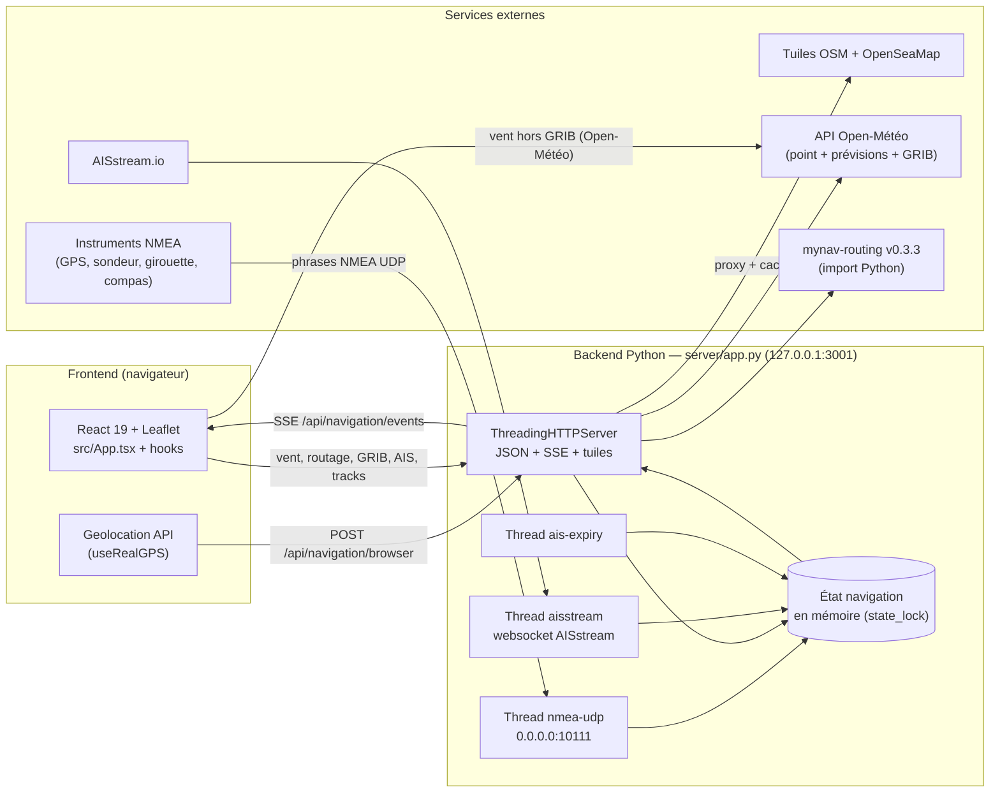

# Architecture MyNavApp

> Photographie de l'architecture **telle qu'elle existe** sur `main` (v1.1.0), rédigée par l'Agent Architecte (issue #64).
> Ce document doit être mis à jour dans la foulée de toute PR qui fait évoluer la structure, les interfaces ou les formats décrits ici.

## 1. Vue d'ensemble

MyNavApp est une application de navigation de plaisance divisée en deux processus :

- un **frontend** React 19 + TypeScript (Vite, Leaflet) tournant dans le navigateur ;
- un **backend** Python (stdlib uniquement pour le serveur HTTP, `server/`) qui collecte les données des instruments, les agrège et les pousse au frontend.

Le moteur de routage (`mynav-routing`) est un paquet pip séparé, épinglé sur tag (`v0.3.3`) via `requirements-routing.txt`.

## 2. Composants

| Couche | Composant | Rôle |
|---|---|---|
| Frontend | `src/App.tsx` | Orchestration : agrège `useNavigationData`, compose les panneaux instruments et la carte |
| Frontend | `src/hooks/useNavigationData.ts` | Point d'agrégation : fusionne NMEA, GPS navigateur et vent en un `NavigationData` |
| Frontend | `src/hooks/useNavigationBackend.ts` | Consomme le SSE `/api/navigation/events`, poste le GPS navigateur |
| Frontend | `src/hooks/useRealGPS.ts` | Geolocation API du navigateur |
| Frontend | `src/hooks/useWindForecast.ts` | Vent du point + grille de barbes (GRIB prioritaire, repli Open-Météo) |
| Frontend | `src/hooks/useRouting*.ts`, `useGrib`, `useTrackRecorder`, `useAISSettings`, `useDashboardLayout` | Routage, GRIB, tracks, AIS, thème/unités/disposition |
| Frontend | `src/components/MapViewSimple.tsx` | Carte Leaflet : bateau, barbes de vent, AIS, routage, tracks |
| Frontend | `src/components/` (Speedometer, WindIndicator, Compass, DepthSounder…) | Instruments |
| Contrat | `shared/navigation.ts` | Types TypeScript partagés, réexportés par `src/types` — contrat unique front/back |
| Backend | `server/app.py` | Serveur HTTP multi-threads, état, SSE, tuiles, AIS, tracks |
| Backend | `server/nmea.py` | Analyse des phrases NMEA (voir §4) |
| Backend | `server/ais.py` | Décodage AIS local (pyais) et des messages AISstream |
| Backend | `server/grib.py` | Téléchargement, statut et échantillonnage GRIB (ecCodes/xarray/cfgrib) |
| Backend | `server/routing.py` | Adaptateur du moteur `mynav-routing` (calcul de route, polaires) |
| Backend | `server/tracks.py` | Enregistreur de traces (JSONL) + export GeoJSON/GPX/CSV |
| Moteur | `mynav-routing` (pip, tag `v0.3.3`) | Routage à voile isochrone, échantillonnage GRIB, GeoJSON |

Le backend n'utilise **aucun framework web** : `http.server` de la stdlib, threads dédiés pour NMEA et AISstream, état global protégé par un `threading.RLock` (`state_lock`).

## 3. Sources de navigation et priorités

Trois sources possibles, choisies par le serveur dans `combine_fields()` puis réordonnées côté front (`useNavigationData`) :

| Source | Alimentée par | Fraîcheur | Priorité |
|---|---|---|---|
| `nmea` | Phrases NMEA reçues en UDP | 5 s (`NMEA_FRESHNESS_MS`) | 1 |
| `browser` | GPS du navigateur (`POST /api/navigation/browser`) | 10 s (`BROWSER_FRESHNESS_MS`) | 2 |
| `none` | — | — | repli |

Règles de fusion (serveur, puis identiques côté front) :

- **position** : NMEA si connecté, sinon navigateur ;
- **vitesse / cap** : fusion champ à champ (`_merge_speed` / `_merge_compass`) — chaque clé garde la dernière valeur non nulle de la source prioritaire, complétée par l'autre source ;
- **profondeur, vent apparent/réel** : NMEA uniquement ;
- **heure GPS** : NMEA sinon navigateur ; **précision GPS** : navigateur (le NMEA ne la transporte pas) ;
- côté front, l'ordre de repli par champ est : NMEA → snapshot backend → GPS local.

## 4. Chaîne NMEA (détail)

### 4.1 Entrée

Le backend écoute en **UDP** sur `NMEA_UDP_HOST:NMEA_UDP_PORT` (défaut `0.0.0.0:10111`). Les instruments (ou un convertisseur NMEA→UDP) envoient des datagrammes contenant une ou plusieurs phrases ASCII, séparées par des sauts de ligne. Le port `0` désactive l'écoute. Chaque ligne est traitée deux fois : d'abord par le décodeur **AIS** local (`LocalAISDecoder`, pyais — phrases AIVDM), puis par l'analyseur NMEA.

### 4.2 Format et validation (`server/nmea.py`)

- Phrase : `$<adresse 5 car.>,<champ1>,…*HH` — le **checksum** est le XOR des caractères entre `$` et `*`, en hexadécimal ;
- une phrase sans `*` est acceptée seulement si elle commence par `$` ;
- validation stricte des plages (minutes < 60, degrés ≤ 90/180, heures ≤ 23, etc.) ; toute phrase invalide est **ignorée silencieusement** (retour `None`) ;
- coordonnées `ddmm.mmm` converties en degrés décimaux, signées `S`/`W` ;
- angles normalisés dans [0, 360) ;
- l'heure GPS (et la date RMC) produit `gpsTime` : `utcTime`, `localTime` (fuseau du serveur), `date`.

### 4.3 Phrases supportées

| Phrase | Champs exploités | Sortie (clés) | Remarques |
|---|---|---|---|
| `RMC` | statut `A`, lat/lon, SOG, COG, heure, date | `position`, `speed`, `compass.cog`, `gpsTime` | phrase GPS recommandée ; ignorée si statut ≠ `A` |
| `GGA` | qualité de fix > 0, lat/lon, heure | `position`, `gpsTime` | |
| `VTG` | COG, SOG | `speed`, `compass.cog` | |
| `HDT` | cap vrai | `compass.heading` | |
| `HDG` | cap magnétique, déviation `E`/`W` | `compass.heading`, `compass.magneticHeading`, `compass.deviation` | déviation en degrés, signée `W` = négatif |
| `DPT` | profondeur (m, champ 1) | `depth` | |
| `DBT` | profondeur (m, champ 3) | `depth` | |
| `MWV` | angle, référence `R`/`T`, vitesse, unité `N`/`M`/`K`, statut `A` | `apparentWind` ou `trueWind` | conversion `M` (m/s) et `K` (km/h) → nœuds ; ignorée si statut ≠ `A` |

Sorties NMEA : `speed` (`speed`, `sog`, `stw` = null, `maxSpeed`, `averageSpeed` — dérivés du SOG), `depth` (`depth`, `temperature` conservée entre phrases, `alarm`, `alarmDepth`).

### 4.4 Fusion d'état et fraîcheur

Chaque phrase valide est fusionnée dans `nmea_navigation` (merge clé par clé, sans écraser les champs absents). Le dernier message reçu rafraîchit `last_nmea_message_at` ; au-delà de **5 s** sans phrase, le backend bascule la source sur `browser`/`none`. Chaque changement d'état déclenche un broadcast SSE (dédupliqué : un message identique n'est pas re-émis).

Tests : `server/test_nmea.py`.

## 5. API HTTP

Toutes les réponses sont JSON (`{ "error": "…" }` en cas d'erreur), `Cache-Control: no-store`, `X-Content-Type-Options: nosniff`. Corps des POST limité à **64 Ko**.

### GET

| Endpoint | Réponse |
|---|---|
| `/api/health` | `{ ok, nmeaUdpEnabled, nmeaUdpPort, production }` |
| `/api/navigation` | Snapshot complet (`BackendNavigationSnapshot`, §6) |
| `/api/navigation/events` | **SSE** : un événement `data:` par changement d'état, keep-alive toutes les 15 s |
| `/api/tiles/{osm\|seamark}/{z}/{x}/{y}.png` | PNG — cache disque (`TILES_DIR`), sinon récupération amont (OSM `a/b/c.tile.openstreetmap.org` ou `tiles.openseamap.org/seamark`), 1 Mo max, cache 24 h |
| `/api/routing/polars` | `{ polars: [{ id, name }] }` |
| `/api/routing/jobs/{jobId}` | État du job asynchrone (`queued`, `running`, `done`, `failed`, `cancelled`), progression brute, résultat ou erreur |
| `/api/grib/status` | `GribStatus` (§6) |
| `/api/tracks` | `{ recorder, tracks }` |
| `/api/tracks/{id}/export?format=geojson\|gpx\|csv` | Pièce jointe GeoJSON / GPX / CSV |

### POST

| Endpoint | Corps | Réponse |
|---|---|---|
| `/api/navigation/browser` | `BrowserNavigationUpdate` (validé par `_valid_browser_update`) | `202` + snapshot |
| `/api/ais/settings` | `{ source: local\|internet, visible: bool }` | `202` + snapshot |
| `/api/ais/replay-position` | `{ position }` ou `{ position: null }` — force la zone AISstream en tests (valide 5 s) | `202 { ok }` |
| `/api/routing/compute` | plan + vent éventuel | `RoutingRouteResult` ; `422` si plan invalide |
| `/api/routing/jobs` | même payload que `/api/routing/compute` | `202 { jobId }` ; calcul isolé en subprocess |
| `/api/grib/download` | `{ south, north, west, east, horizonH = 72 }` | `GribStatus` ; `503` si échec |
| `/api/grib/sample` | `{ points }` — **≤ 400 positions** | `{ fresh: bool, wind: [] }` ; `fresh: false` si le GRIB n'est pas frais, `503` en erreur |
| `/api/tracks/start`, `/api/tracks/stop` | — | `202 { recorder, tracks, stopped }` ; `409` si conflit |

### DELETE

| Endpoint | Réponse |
|---|---|
| `/api/routing/jobs/{jobId}` | Annule le subprocess ; état du job (`cancelled`), idempotent ; `404` si inconnu |
| `/api/tracks/{id}` | `202 { recorder, tracks }` ; `404` si inconnue, `409` si en cours |

Le calcul synchrone `/api/routing/compute` reste disponible sans changement. Les jobs asynchrones sont exécutés dans un subprocess (mode `spawn`) pour isoler le calcul du serveur ; `GET /api/routing/jobs/{jobId}` expose les temps de phase cumulés et le nombre de nœuds explorés, sans pourcentage estimé. Les jobs terminés sont purgés après 30 minutes.

En production (`NODE_ENV=production`), le backend sert aussi le build statique `dist/` (SPA : les chemins sans extension retombent sur `index.html`). En dev, Vite route `/api` vers `127.0.0.1:3001` (proxy `vite.config.ts`).

## 6. Modèle de données partagé (`shared/navigation.ts`)

Contrat unique entre backend (dictionnaires Python) et frontend (interfaces TS, réexportées par `src/types`).

| Interface | Contenu |
|---|---|
| `Position` | `latitude`, `longitude` |
| `SpeedData` | `speed`, `sog`, `stw`, `maxSpeed`, `averageSpeed` (nœuds) |
| `WindData` | `direction`, `speed`, `gust`, `source: 'Open-Meteo' \| 'GRIB'` |
| `ApparentWindData` / `trueWind` | `angleDegrees`, `speedKnots` (issus MWV) |
| `CompassData` | `heading`, `cog`, `magneticHeading`, `deviation` |
| `DepthData` | `depth` (m), `temperature`, `alarm`, `alarmDepth` |
| `GPSTime` | `utcTime`, `localTime`, `date` (chaînes formatées) |
| `NavigationData` | Agrégat consommé par les instruments : position, vitesse, vent + grille + statut, cap, profondeur, heure, précision |
| `BackendNavigationSnapshot` | `source: 'nmea'\|'browser'\|'none'`, `nmeaConnected`, `updatedAt`, `navigation`, `ais` |
| `AISTarget` | `mmsi`, `name`, position, `sog`, `cog`, `heading`, `navigationalStatus`, `updatedAt` |
| `AISBackendState` | `source` (effective), `requestedSource`, `localNmeaPort`, `targets`, compteurs, état internet |
| `GribStatus` | `available`, `fresh`, `reason`, `createdAt`, `validUntil`, emprise, résolution, pas horaire |
| `RoutingPlan` / `RoutingWindInput` | départ/arrivée/polaire ; vent constant `directionFromDeg` + `speedKts` |
| `RoutingRouteResult` | `found`, `coords [lon, lat]`, `etaS`, `dtS`, `minDistNm`, `geojson`, `windSource: 'grib'\|'constant'`, ajustements terre→eau (`offsetNm`) |
| `TrackRecorderStatus` / `TrackSummary` / `TracksResponse` | état de l'enregistreur, métadonnées des traces |
| `DashboardLayout` / `InstrumentConfig` | disposition des instruments, thème (`light`/`dark`/`night`), unités |

## 7. Vent

- **Vent du point** (instrument WIND) : Open-Météo prévisions, ou GRIB local (option B, #36) — `WindData.source` distingue les deux.
- **Grille de barbes** : `useWindForecast.requestWindGrid()` est appelé par la carte avec un maillage géographique (~85 px à l'écran). Priorité **GRIB** via `POST /api/grib/sample` (emprise du dernier routage + 0,5°) ; repli **Open-Météo** par lots de 50 points espacés de 300 ms.
- Cache front de 2 000 entrées, clé de position à 5 décimales (~1 m) ; backoff exponentiel 5→60 min en cas de HTTP 429 ; erreurs de grille exposées par `WindForecastStatus.gridError`.
- Limites connues à fort zoom : voir #55 et les issues de suivi #60-#63.

## 8. GRIB

Téléchargement (Open-Météo) via `POST /api/grib/download`, piloté automatiquement par l'app dès qu'un plan de routage est prêt (marge 1°, horizon 72 h). Stockage/lecture via **ecCodes** (wheel pip, ≥ 2.43) + xarray/cfgrib. `GribStatus.fresh`/`validUntil` gouvernent l'usage ; à bord sans réseau, l'app prévient et retombe sur un vent constant pour le routage.

## 9. AIS

- **Local** : phrases AIVDM du flux NMEA UDP décodées par pyais (`server/ais.py`).
- **Internet** : websocket AISstream.io (clé `AISSTREAM_API_KEY`), bbox ±0,25° de latitude (longitude ajustée par cosinus), ré-abonnement si le bateau bouge ≥ 0,1°, reconnexion exponentielle 2→60 s.
- **Fallback** : si la source demandée est `local` mais qu'aucune cible locale n'est fraîche et qu'une clé est configurée, l'internet prend le relais ; retour au local dès qu'une phrase AIS locale arrive.
- Cibles expirées après 10 min ; snapshot limité à 1 500 cibles (tri par fraîcheur) ; `POST /api/ais/replay-position` permet de forcer la zone en test.

## 10. Routage

Le panneau de routage construit un `RoutingPlan` (départ = position courante ou choisie sur carte, arrivée, polaire — `config/polaire-sugar.pol` par défaut). `POST /api/routing/compute` transmet au moteur **mynav-routing** (import Python, épinglé `v0.3.3`) : vent GRIB si frais, sinon vent constant issu des instruments. Le résultat (trace `coords`, `etaS`, GeoJSON) est affiché par la carte ; les points à terre sont rapprochés de l'eau la plus proche (`startAdjusted`/`finishAdjusted`, `offsetNm`). Politique d'épinglage : tags uniquement, bump par l'Agent Intégrateur après chaque release du moteur (cf. #56).

## 11. Tracks

Le backend enregistre la navigation consolidée dans `TRACKS_DIR` (défaut `./tracks`) : **un fichier JSONL par enregistrement**, points ajoutés à chaque broadcast. Démarrage/arrêt via `POST /api/tracks/start|stop`, liste via `GET /api/tracks`, export GeoJSON/GPX/CSV, suppression `DELETE /api/tracks/{id}`. Tests : `server/test_tracks.py`.

## 12. Tuiles

Le backend proxifie les tuiles **OSM** et **OpenSeaMap** (seamarks) avec cache disque dans `TILES_DIR` (défaut `./tiles`), User-Agent dédié, validation PNG et taille ≤ 1 Mo. `tools/download_tiles.py` permet de pré-remplir le cache pour naviguer hors ligne.

## 13. Configuration et déploiement

| Variable | Défaut | Rôle |
|---|---|---|
| `HOST` / `PORT` | `127.0.0.1` / `3001` | Écoute HTTP du backend |
| `NMEA_UDP_HOST` / `NMEA_UDP_PORT` | `0.0.0.0` / `10111` | Écoute NMEA UDP (port `0` = désactivé) |
| `TILES_DIR` / `TRACKS_DIR` | `./tiles` / `./tracks` | Cache tuiles / traces JSONL |
| `AISSTREAM_API_KEY` | vide | Active l'AIS internet |
| `NODE_ENV=production` | — | Le backend sert `dist/` (SPA) |
| `VITE_HTTPS_CERT` / `VITE_HTTPS_KEY` | vide | HTTPS du serveur Vite en LAN (mkcert) — requis pour la géolocalisation sur appareils mobiles |

Scripts : `npm run dev` (backend + Vite via concurrently), `dev:lan`/`start:lan` (écoute LAN), `build` (tsc + vite), `start` (prod), `test:front` (vitest), `test:server` (unittest : nmea, ais, grib, http, routing, tiles, tracks, config).

⚠️ Pas d'authentification ni de HTTPS sur le backend : boucleback par défaut ; l'exposition LAN est déconseillée hors réseau de confiance (avertissement au démarrage).

## 14. Limites connues (pistes ouvertes)

- Perf d'affichage carte et fiabilité des barbes à fort zoom : #55, suivi #60 (investigation), #61 (transitions/mémoïsation), #62 (clé de cache + rate-limit), #63 (couche canvas).
- Affichage ETA / SOG : #18.
- Performance du moteur de routage : mynav-routing #14 et #16-#20.
- Pas d'authentification backend (usage monoposte/LAN de confiance).
