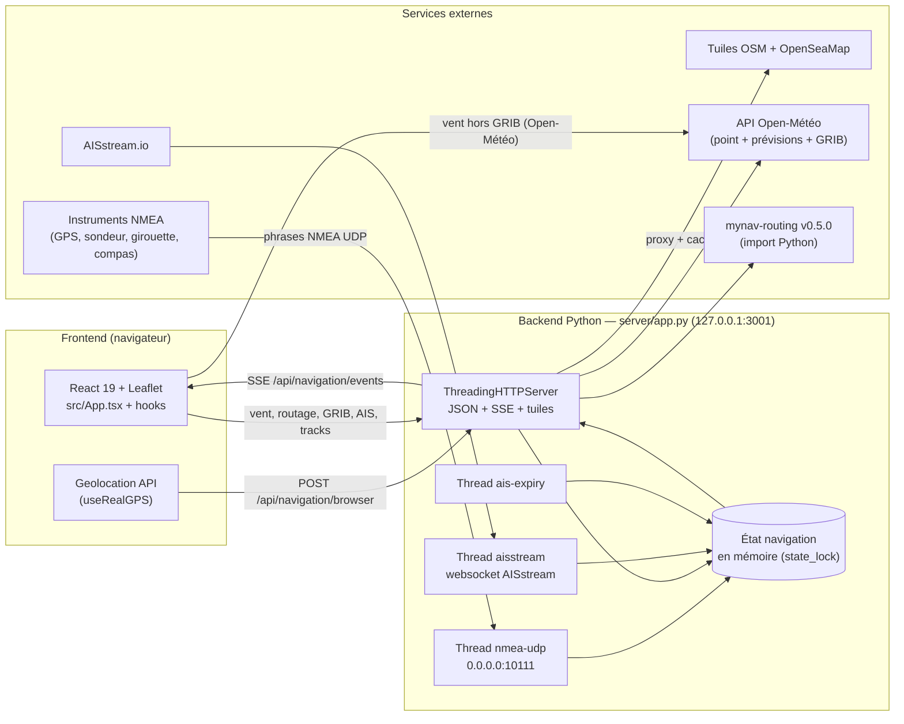

# Architecture MyNavApp

> Photographie de l'architecture **telle qu'elle existe** sur `main` (v1.3.0), rédigée par l'Agent Architecte (issue #64).
> Ce document doit être mis à jour dans la foulée de toute PR qui fait évoluer la structure, les interfaces ou les formats décrits ici.

## 1. Vue d'ensemble

MyNavApp est une application de navigation de plaisance divisée en deux processus :

- un **frontend** React 19 + TypeScript (Vite, Leaflet) tournant dans le navigateur ;
- un **backend** Python (stdlib uniquement pour le serveur HTTP, `server/`) qui collecte les données des instruments, les agrège et les pousse au frontend.

Le moteur de routage (`mynav-routing`) est un paquet pip séparé, épinglé via `requirements-routing.txt` sur le tag **`v0.5.0`** (corridor + crosses_land + repli sans corridor + campagne d'acceptation + relais moteur B1 ; politique d'épinglage sur tags #56).

## 2. Composants

| Couche | Composant | Rôle |
|---|---|---|
| Frontend | `src/App.tsx` | Orchestration : agrège `useNavigationData`, compose les panneaux instruments et la carte |
| Frontend | `src/hooks/useNavigationData.ts` | Point d'agrégation : fusionne NMEA, GPS navigateur et vent en un `NavigationData` |
| Frontend | `src/hooks/useNavigationBackend.ts` | Consomme le SSE `/api/navigation/events`, poste le GPS navigateur |
| Frontend | `src/hooks/useRealGPS.ts` | Geolocation API du navigateur |
| Frontend | `src/hooks/useWindForecast.ts` | Vent du point + grille de barbes (GRIB prioritaire, repli Open-Météo) |
| Frontend | `src/hooks/useRouting*.ts`, `useGrib`, `useTrackRecorder`, `useAISSettings`, `useDashboardLayout` | Routage, GRIB, tracks, AIS, thème/unités/disposition |
| Frontend | `src/components/MapViewSimple.tsx` | Carte Leaflet : bateau, barbes de vent, AIS, routage, tracks |
| Frontend | `src/hooks/useMotionSensors.ts` + `src/utils/motion.ts` + `src/components/MotionPanel.tsx` | Capteurs de mouvement de la tablette : gîte, tangage, période de roulis (DeviceMotion, Firefox Android — #152) |
| Frontend | `src/utils/routeCursor.ts` + `src/components/RouteTimeCursor.tsx` | Curseur temporel de la route : position/cap/SOG interpolés à un instant choisi (A2 #154) |
| Frontend | `src/components/` (Speedometer, WindIndicator, Compass, DepthSounder…) | Instruments |
| Frontend | `src/utils/instrumentPrimitives.ts` + `src/components/instruments/InstrumentCard.tsx` | Fondations de la refonte instruments (Phase 0 #156) : primitives SVG (0° en haut, sens horaire), carte générique avec bascule cadran ⇄ numérique par instrument ; phases suivantes : panneau HELM, COASTAL/OVERVIEW, PREP ROUTING |
| Frontend | `src/components/instruments/HelmPanel.tsx` + `CompassDial.tsx` | Refonte instruments Phase 1 (#158) : panneau HELM — instrument central commutable VENT/COMPAS/VITESSE, compas **COURSE-UP** (rose tournée de -COG, HDG ambre), VMG = SOG×cos(TWA) ; STW en `--` tant que la phrase VHW (loch) n'est pas reçue (§4) |
| Frontend | `src/utils/instrumentMode.ts` + `CoastalPanel.tsx` + `OverviewPanel.tsx` + `WindDial.tsx` + `InstrumentModesPanel.tsx` | Refonte instruments Phase 2 (#160) : modes commutables **HELM/COASTAL/OVERVIEW** persistés (`mynav:ui-mode`, rétro-compat `?helm=1`), COASTAL (vent resserré WindDial 170 px + tuiles 2×2 DEPTH/SOG/COG/HDG avec alarme), OVERVIEW (position/cap/vent/profondeur/heure), **mode cadran ⇄ numérique persisté par instrument** (`mynav:instrument-mode:<titre>` via InstrumentCard) |
| Frontend | `src/components/instruments/PrepRoutingPanel.tsx` + `InstrumentModesPanel.tsx` (onglet PREP) | Refonte instruments Phase 3 (#162) : onglet **PREP ROUTING** dans la stack instruments — START/FINISH avec sélection sur la carte, COMPUTE + progression/annulation, statut GRIB (fresh/expiré/absent), résumé route (DISTANCE/DURATION/ETA/WIND) ; réutilise les hooks de routage existants (`useRoutingInput`, `useRoutingRoute`, `useGrib`), mode `prep` via `?ui=prep` persisté |
| Frontend | `src/utils/autoMode.ts` + `CoastalPanel.tsx` (bannière SHALLOW) + `InstrumentModesPanel.tsx` (toggle AUTO) | Refonte instruments Phase 4 (#164) : bannière **SHALLOW** dans COASTAL à l'alarme profondeur (role alert, profondeur + seuil) ; **auto-switch** vers COASTAL sur alarme profondeur — opt-in « AUTO » persisté (`mynav:ui-auto`, désactivé par défaut), pas de ping-pong (bascule unique, reprise en main manuelle), avis role status |
| Frontend | `src/utils/instrumentMode.ts` (défaut HELM + `?ui=legacy`) + `BottomInstrumentsPanel.tsx` + `HelmPanel.tsx`/`index.css` | Refonte instruments — finalisation (#166) : **nouveaux rendus par défaut** (HELM au lancement sans URL, échappatoire `?ui=legacy`) ; **rangée basse en InstrumentCard** (WIND WindDial + DEPTH numérique sans bascule, alarme mise en avant) ; **alignement maquettes revue 2** — compacts HELM à droite du central (colonnes), jumelage SOG·STW partout (compact + central VITESSE) ; InstrumentCard `hideToggle` |
| Frontend | `src/components/instruments/WindDial.tsx` | WindDial façon Raymarine (#168) — style de référence consigné (Raymarine Alpha) : arcs **rouge bâbord / vert tribord**, aiguille depuis le bateau (silhouette au centre) vers la provenance, vignette digitale **TWS + TWD** ; API inchangée (twdDeg/twsKts/size), sans donnée → `--` unique |
| Frontend | `src/App.tsx` + `InstrumentModesPanel.tsx` + `OverviewPanel.tsx` | Layout instruments (#170) : carte UNIQUEMENT sur OVERVIEW (tuiles OverviewPanel en bandeau `overview-strip` AU-DESSUS de la carte) et PREP — HELM/COASTAL = écrans d'instruments purs sans carte (`main-layout-no-map`, props `onModeChange`/`hideActivePanel`, MapView non monté) |
| Frontend | `src/App.tsx` + `InstrumentModesPanel.tsx` + `MapViewSimple.tsx` + `index.css` | Mise en page v3 (#172) : **barre de modes en haut pleine largeur** (panneaux rendus par App selon le mode) ; HELM/COASTAL = **scène d'instruments plein écran** (HelmPanel/CoastalPanel + MotionPanel + rangée basse, pas de zone vide) ; OVERVIEW/ROUTING = **tuiles OverviewPanel au-dessus de la carte** ; vue ROUTING = **cartouche `routing-cartouche` avec le RoutingPanel complet** (PrepRoutingPanel supprimé) ; `MapViewSimple.hideRoutingTool` masque l'outil routing carte en OVERVIEW/ROUTING (legacy inchangé) |
| Frontend | `src/App.tsx` + `MapViewSimple.tsx` + `index.css` | Carte plein cadre #174 : **ResizeObserver → `map.invalidateSize()`** (la carte occupe l'espace libre aux changements de vue/resize, plus de zones grises), `.ui-stage-map` en colonne (bandeau tuiles AU-DESSUS, `.ui-stage-map-body` = carte + cartouche), `.map-view` sans bord ; **thèmes light/dark/night respectés** (topbar + tuiles + boutons sur variables `--bg-*`/`--text-*`/`--border-color`, plus de couleurs codées en dur) ; **lisibilité relevée** (valeurs tuiles 1.45rem, labels 0.7rem) ; fermeture défensive de l'outil routing carte quand `hideRoutingTool` |
| Frontend | `src/components/instruments/WindDial.tsx`(+test) + `HelmPanel.tsx` + `index.css` | **Régression #169 réparée (#176)** : la version Raymarine du WindDial n'avait jamais atteint le composant réel (PR #169 avait poussé `WindDial.tsx` à la RACINE du repo — fichiers morts supprimés) ; WindDial réécrit : **arcs rouge bâbord / vert tribord**, silhouette bateau, aiguille à la provenance, vignette **TWS + TWD**, `--` unique sans donnée, API inchangée (CoastalPanel/rangée basse réparés sans modification) ; **HELM amélioré** : central VENT = grand WindDial 280px + ligne TWA·AWA, lisibilité relevée (valeurs 3.4rem, VMG 0.75rem) |
| Frontend | `src/components/instruments/HelmPanel.tsx` + `InstrumentCard.tsx` + `index.css` + `tools/visual_shots.mjs` | HELM central 2/3 + tuiles 1/3 (#182) puis **switch digital ⇄ cadran du central** (#184, retour n°21) : bouton 123/◉ **contrôlé par HelmPanel** (props `mode`/`onModeChange`/`toggleDisabled` d'InstrumentCard) — actif pour COMPAS/VENT (vue digitale : COG énorme + HDG ambre, TWS énorme + AWS/TWA/AWA), **visible mais désactivé** pour les instruments sans cadran (vitesse/profondeur/heure/position, cadrans à créer) ; colonne droite ordre **TIME, POSITION, SOG, TWS, COG, DEPTH**, les six tuiles **toujours visibles** (le clic affiche au centre, plus de permutation), tuile active **surlignée** (cadre accent + pastille) |
| Contrat | `shared/navigation.ts` | Types TypeScript partagés, réexportés par `src/types` — contrat unique front/back |
| Backend | `server/app.py` | Serveur HTTP multi-threads, état, SSE, tuiles, AIS, tracks |
| Backend | `server/nmea.py` | Analyse des phrases NMEA (voir §4) |
| Backend | `server/ais.py` | Décodage AIS local (pyais) et des messages AISstream |
| Backend | `server/grib.py` | Téléchargement, statut et échantillonnage GRIB (ecCodes/xarray/cfgrib) |
| Backend | `server/routing.py` | Adaptateur du moteur `mynav-routing` (calcul de route, polaires) |
| Backend | `server/tracks.py` | Enregistreur de traces (JSONL) + export GeoJSON/GPX/CSV |
| Moteur | `mynav-routing` (pip, pin `v0.5.0`) | Routage à voile isochrone, échantillonnage GRIB, relais moteur B1, GeoJSON |

Le backend n'utilise **aucun framework web** : `http.server` de la stdlib, threads dédiés pour NMEA et AISstream, état global protégé par un `threading.RLock` (`state_lock`).

## 3. Sources de navigation et priorités

Trois sources possibles, choisies par le serveur dans `combine_fields()` puis réordonnées côté front (`useNavigationData`) :

| Source | Alimentée par | Fraîcheur | Priorité |
|---|---|---|---|
| `nmea` | Phrases NMEA reçues en UDP | 5 s (`NMEA_FRESHNESS_MS`) | 1 |
| `browser` | GPS du navigateur (`POST /api/navigation/browser`) | 10 s (`BROWSER_FRESHNESS_MS`) | 2 |
| `none` | — | — | repli |

Règles de fusion (serveur, puis identiques côté front) :

- **position** : NMEA si connecté, sinon navigateur ;
- **vitesse / cap** : fusion champ à champ (`_merge_speed` / `_merge_compass`) — chaque clé garde la dernière valeur non nulle de la source prioritaire, complétée par l'autre source ;
- **profondeur, vent apparent/réel** : NMEA uniquement ;
- **heure GPS** : NMEA sinon navigateur ; **précision GPS** : navigateur (le NMEA ne la transporte pas) ;
- côté front, l'ordre de repli par champ est : NMEA → snapshot backend → GPS local.

## 4. Chaîne NMEA (détail)

### 4.1 Entrée

Le backend écoute en **UDP** sur `NMEA_UDP_HOST:NMEA_UDP_PORT` (défaut `0.0.0.0:10111`). Les instruments (ou un convertisseur NMEA→UDP) envoient des datagrammes contenant une ou plusieurs phrases ASCII, séparées par des sauts de ligne. Le port `0` désactive l'écoute. Chaque ligne est traitée deux fois : d'abord par le décodeur **AIS** local (`LocalAISDecoder`, pyais — phrases AIVDM), puis par l'analyseur NMEA.

### 4.2 Format et validation (`server/nmea.py`)

- Phrase : `$<adresse 5 car.>,<champ1>,…*HH` — le **checksum** est le XOR des caractères entre `$` et `*`, en hexadécimal ;
- une phrase sans `*` est acceptée seulement si elle commence par `$` ;
- validation stricte des plages (minutes < 60, degrés ≤ 90/180, heures ≤ 23, etc.) ; toute phrase invalide est **ignorée silencieusement** (retour `None`) ;
- coordonnées `ddmm.mmm` converties en degrés décimaux, signées `S`/`W` ;
- angles normalisés dans [0, 360) ;
- l'heure GPS (et la date RMC) produit `gpsTime` : `utcTime`, `localTime` (fuseau du serveur), `date`.

### 4.3 Phrases supportées

| Phrase | Champs exploités | Sortie (clés) | Remarques |
|---|---|---|---|
| `RMC` | statut `A`, lat/lon, SOG, COG, heure, date | `position`, `speed`, `compass.cog`, `gpsTime` | phrase GPS recommandée ; ignorée si statut ≠ `A` |
| `GGA` | qualité de fix > 0, lat/lon, heure | `position`, `gpsTime` | |
| `VTG` | COG, SOG | `speed`, `compass.cog` | |
| `HDT` | cap vrai | `compass.heading` | |
| `HDG` | cap magnétique, déviation `E`/`W` | `compass.heading`, `compass.magneticHeading`, `compass.deviation` | déviation en degrés, signée `W` = négatif |
| `DPT` | profondeur (m, champ 1) | `depth` | |
| `DBT` | profondeur (m, champ 3) | `depth` | |
| `MWV` | angle, référence `R`/`T`, vitesse, unité `N`/`M`/`K`, statut `A` | `apparentWind` ou `trueWind` | conversion `M` (m/s) et `K` (km/h) → nœuds ; ignorée si statut ≠ `A` |

Sorties NMEA : `speed` (`speed`, `sog`, `stw` = null, `maxSpeed`, `averageSpeed` — dérivés du SOG), `depth` (`depth`, `temperature` conservée entre phrases, `alarm`, `alarmDepth`).

### 4.4 Fusion d'état et fraîcheur

Chaque phrase valide est fusionnée dans `nmea_navigation` (merge clé par clé, sans écraser les champs absents). Le dernier message reçu rafraîchit `last_nmea_message_at` ; au-delà de **5 s** sans phrase, le backend bascule la source sur `browser`/`none`. Chaque changement d'état déclenche un broadcast SSE (dédupliqué : un message identique n'est pas re-émis).

Tests : `server/test_nmea.py`.

## 5. API HTTP

Toutes les réponses sont JSON (`{ "error": "…" }` en cas d'erreur), `Cache-Control: no-store`, `X-Content-Type-Options: nosniff`. Corps des POST limité à **64 Ko**.

### GET

| Endpoint | Réponse |
|---|---|
| `/api/health` | `{ ok, nmeaUdpEnabled, nmeaUdpPort, production }` |
| `/api/navigation` | Snapshot complet (`BackendNavigationSnapshot`, §6) |
| `/api/navigation/events` | **SSE** : un événement `data:` par changement d'état, keep-alive toutes les 15 s |
| `/api/tiles/{osm\|seamark}/{z}/{x}/{y}.png` | PNG — cache disque (`TILES_DIR`), sinon récupération amont (OSM `a/b/c.tile.openstreetmap.org` ou `tiles.openseamap.org/seamark`), 1 Mo max, cache 24 h |
| `/api/routing/polars` | `{ polars: [{ id, name }] }` |
| `/api/routing/jobs/{jobId}` | État du job asynchrone (`queued`, `running`, `done`, `failed`, `cancelled`), progression brute, résultat ou erreur |
| `/api/grib/status` | `GribStatus` (§6) |
| `/api/tracks` | `{ recorder, tracks }` |
| `/api/tracks/{id}/export?format=geojson\|gpx\|csv` | Pièce jointe GeoJSON / GPX / CSV |

### POST

| Endpoint | Corps | Réponse |
|---|---|---|
| `/api/navigation/browser` | `BrowserNavigationUpdate` (validé par `_valid_browser_update`) | `202` + snapshot |
| `/api/ais/settings` | `{ source: local\|internet, visible: bool }` | `202` + snapshot |
| `/api/ais/replay-position` | `{ position }` ou `{ position: null }` — force la zone AISstream en tests (valide 5 s) | `202 { ok }` |
| `/api/routing/compute` | plan (le champ `wind` du client est ignoré — autorité vent serveur, C2/#102 ; `engineBelowKts` optionnel : seuil moteur B1, 0 < x ≤ 10, absent/null = pur voile) | `RoutingRouteResult` (avec `motorFlags` par point + echo `engineBelowKts` ; `wind` = **echo du vent réellement utilisé au départ** #135 — GRIB échantillonné si `windSource == 'grib'`, vent du plan en constant — et `windAvg` = moyenne **vectorielle** u/v le long de la route, `null` hors GRIB ou si échec d'échantillonnage ; `startInGrib` (#141) : `false` = départ hors zone du champ GRIB — le moteur nearest-clippe sans erreur, le panneau affiche un avertissement, `null` = vent sans emprise connue) ; `422` si plan invalide |
| `/api/routing/jobs` | même payload que `/api/routing/compute` | `202 { jobId }` ; calcul isolé en subprocess ; `429` si trop de jobs actifs (R2) |
| `/api/grib/download` | `{ south, north, west, east, horizonH = 72 }` | `GribStatus` ; `503` si échec |
| `/api/grib/sample` | `{ points }` — **≤ 400 positions** | `{ fresh: bool, wind: [] }` ; `fresh: false` si le GRIB n'est pas frais, `503` en erreur |
| `/api/tracks/start`, `/api/tracks/stop` | — | `202 { recorder, tracks, stopped }` ; `409` si conflit |

### DELETE

| Endpoint | Réponse |
|---|---|
| `/api/routing/jobs/{jobId}` | Annule le subprocess ; état du job (`cancelled`), idempotent ; `404` si inconnu |
| `/api/tracks/{id}` | `202 { recorder, tracks }` ; `404` si inconnue, `409` si en cours |

Le calcul synchrone `/api/routing/compute` reste disponible sans changement. Les jobs asynchrones sont exécutés dans un subprocess (mode `spawn`) pour isoler le calcul du serveur ; `GET /api/routing/jobs/{jobId}` expose les temps de phase cumulés et le nombre de nœuds explorés, sans pourcentage estimé. Les jobs terminés sont purgés après 30 minutes. Le nombre de jobs actifs (`queued` + `running`) est plafonné (`ROUTING_MAX_ACTIVE_JOBS`, défaut 2) : au-delà, `POST /api/routing/jobs` répond `429` avec un message clair (R2). Justifications et garanties internes (reaping à propriétaire unique, terminate→kill, spawn-safe) : **ADR-0003** (`docs/adr/`).

En production (`NODE_ENV=production`), le backend sert aussi le build statique `dist/` (SPA : les chemins sans extension retombent sur `index.html`). En dev, Vite route `/api` vers `127.0.0.1:3001` (proxy `vite.config.ts`).

## 6. Modèle de données partagé (`shared/navigation.ts`)

Contrat unique entre backend (dictionnaires Python) et frontend (interfaces TS, réexportées par `src/types`).

| Interface | Contenu |
|---|---|
| `Position` | `latitude`, `longitude` |
| `SpeedData` | `speed`, `sog`, `stw`, `maxSpeed`, `averageSpeed` (nœuds) |
| `WindData` | `direction`, `speed`, `gust`, `source: 'Open-Meteo' \| 'GRIB'` |
| `ApparentWindData` / `trueWind` | `angleDegrees`, `speedKnots` (issus MWV) |
| `CompassData` | `heading`, `cog`, `magneticHeading`, `deviation` |
| `DepthData` | `depth` (m), `temperature`, `alarm`, `alarmDepth` |
| `GPSTime` | `utcTime`, `localTime`, `date` (chaînes formatées) |
| `NavigationData` | Agrégat consommé par les instruments : position, vitesse, vent + grille + statut, cap, profondeur, heure, précision |
| `BackendNavigationSnapshot` | `source: 'nmea'\|'browser'\|'none'`, `nmeaConnected`, `updatedAt`, `navigation`, `ais` |
| `AISTarget` | `mmsi`, `name`, position, `sog`, `cog`, `heading`, `navigationalStatus`, `updatedAt` |
| `AISBackendState` | `source` (effective), `requestedSource`, `localNmeaPort`, `targets`, compteurs, état internet |
| `GribStatus` | `available`, `fresh`, `reason`, `createdAt`, `validUntil`, emprise, résolution, pas horaire |
| `RoutingPlan` / `RoutingWindInput` | départ/arrivée/polaire + `engineBelowKts` (seuil moteur B1, défaut 2, `null` = pur voile) ; `RoutingWindInput` = echo du repli constant **dérivé par le serveur** (C2/#102), `null` si le GRIB sert au calcul |
| `RoutingRouteResult` | `found`, `coords [lon, lat]`, `etaS`, `timesS`/`sogKts` à chaque point du tracé (#18, `len == len(coords)`, `timesS[last] == etaS`), `motorFlags` par point (B1/#133, même convention #123, `null` = pur voile) + echo `engineBelowKts`, `startInGrib` (#141 : `false` = départ hors zone du champ GRIB, `null` = vent sans emprise connue), `dtS`, `minDistNm`, `geojson` (`properties.motor` si relais actif), `windSource: 'grib'\|'constant'`, `wind` (echo du vent utilisé au départ, #135), `windAvg` (moyenne vectorielle le long de la route, GRIB seulement), ajustements terre→eau (`offsetNm`) |
| `TrackRecorderStatus` / `TrackSummary` / `TracksResponse` | état de l'enregistreur, métadonnées des traces |
| `DashboardLayout` / `InstrumentConfig` | disposition des instruments, thème (`light`/`dark`/`night`), unités |

## 7. Vent

- **Vent du point** (instrument WIND) : **GRIB-first** comme les barbes (#140) — `POST /api/grib/sample` (vent échantillonné à l'heure courante si GRIB frais + position couverte, marge 1 maille), repli Open-Météo prévisions sinon (comportement #36) ; le badge du panneau affiche `WindData.source` (`GRIB` / `Open-Meteo`).
- **Grille de barbes** : `useWindForecast.requestWindGrid()` est appelé par la carte avec un maillage géographique (~85 px à l'écran). Priorité **GRIB** via `POST /api/grib/sample` (emprise du dernier routage + 0,5°) ; repli **Open-Météo** par lots de 50 points espacés de 300 ms.
- Cache front de 2 000 entrées, clé de position à 5 décimales (~1 m) ; backoff exponentiel 5→60 min en cas de HTTP 429 ; erreurs de grille exposées par `WindForecastStatus.gridError`.
- Limites connues à fort zoom : voir #55 et les issues de suivi #60-#63.
- **Routage — autorité vent serveur (ADR-0004)** : le calcul du routage n'utilise jamais un vent envoyé par le client. GRIB frais prioritaire, sinon repli constant dérivé du NMEA du serveur (MWV vent vrai + cap), sinon refus clair (C2, #102/#103). Le vent affiché (point/barbes) et le vent du routage peuvent donc différer **par construction** — la vérité du calcul est `RoutingRouteResult.windSource`.

## 8. GRIB

Téléchargement (Open-Météo) via `POST /api/grib/download`, piloté automatiquement par l'app dès qu'un plan de routage est prêt (marge 1°, horizon 72 h). Stockage/lecture via **ecCodes** (wheel pip, ≥ 2.43) + xarray/cfgrib. `GribStatus.fresh`/`validUntil` gouvernent l'usage ; à bord sans réseau, l'app prévient ; le routage retombe alors sur le vent constant du serveur (MWV vent vrai + cap, cf. ADR-0004), ou échoue avec un message clair si les instruments ne fournissent pas de vent vrai.

## 9. AIS

- **Local** : phrases AIVDM du flux NMEA UDP décodées par pyais (`server/ais.py`).
- **Internet** : websocket AISstream.io (clé `AISSTREAM_API_KEY`), bbox ±0,25° de latitude (longitude ajustée par cosinus), ré-abonnement si le bateau bouge ≥ 0,1°, reconnexion exponentielle 2→60 s.
- **Fallback** : si la source demandée est `local` mais qu'aucune cible locale n'est fraîche et qu'une clé est configurée, l'internet prend le relais ; retour au local dès qu'une phrase AIS locale arrive.
- Cibles expirées après 10 min ; snapshot limité à 1 500 cibles (tri par fraîcheur) ; `POST /api/ais/replay-position` permet de forcer la zone en test.

## 10. Routage

Le panneau de routage construit un `RoutingPlan` (départ = position courante ou choisie sur carte, arrivée, polaire — `config/polaire-sugar.pol` par défaut — et seuil moteur `engineBelowKts`, champ « Motor below (kt) », défaut 2, vide = pur voile). `POST /api/routing/compute` transmet au moteur **mynav-routing** (import Python, pin `v0.6.0`) : vent GRIB si frais, sinon vent constant dérivé du NMEA du serveur (MWV vent vrai + cap — autorité vent serveur, C2/#102 : le client n'envoie plus de vent). Le résultat (trace `coords`, `etaS`, `timesS`/`sogKts`, `motorFlags`, GeoJSON) est affiché par la carte et le panneau — **relais moteur B1 (#133)** : sous le seuil de vitesse voile, le tronçon passe en moteur à 4,0 kt (`ENGINE_SPEED_KTS`), cap inchangé ; les tronçons moteur sont tracés en trait orange pointillé distinct (`MapViewSimple.tsx`), les jambes concernées marquées MOTOR dans la fiche (`routeLegs.ts` — une jambe mixte voile+moteur est marquée si elle contient au moins un tronçon moteur) ; une route au vent par pétoire, introuvable en pur voile, devient trouvable — heure d'arrivée locale et sparkline SOG (#18) ; **echo du vent utilisé (#135)** : la ligne sous ETA affiche le vent réellement pris en compte au départ (`GRIB wind from …° · … kt` ou `constant … kt from …°`) et, en source GRIB, la moyenne vectorielle le long de la route (`avg along route … kt from …°`) ; **départ hors zone GRIB (#141)** : quand le départ n'est pas dans l'emprise du champ, le moteur nearest-clippe silencieusement (vent du bord de grille, sans erreur) — `startInGrib: false` remonté dans le résultat, le panneau affiche un avertissement « departure outside GRIB coverage » (null = vent sans emprise connue, ex. constant) — le panneau WIND du point est GRIB-first (#140) — il coïncide avec le vent du calcul quand le GRIB est frais et couvre la position, mais peut retomber sur Open-Météo (badge source) ; fiche route détaillée repliable (#121, #124) — jambes à cap quasi constant (seuil 5°), heure de passage, SOG moyen et distance par jambe, dérivés côté client dans `src/utils/routeLegs.ts`, table ouverte dans un bloc flottant à côté du panneau (pas en dessous, `RouteDetails.tsx`) — rendu en portal vers `document.body` et positionné en `fixed` ancré au bouton toggle, hors du panneau de routage dont l'`overflow-y: auto` clipperait tout descendant positionné sortant (#127 ; repli géométrique en dessous si la place manque à gauche, `src/utils/popoverPosition.ts`) ; #129 : bloc décalé au-dessus du bouton et hauteur étirée jusqu'au bas de la fenêtre (max-height inline, panel en flex column) — la table affiche un maximum de jambes sans sortir de l'écran ; #137 : quand la route contient des jambes moteur, le bloc s'élargit de 17rem à 20rem (largeur effective passée à `computePopoverPosition`) pour que la table tienne sans comprimer/décaler les colonnes `nowrap` ; #139 : ces routes affichent une **colonne dédiée MOTOR** (Time · MOTOR · Hdg · SOG · Dist — badge centré, cellule vide pour les jambes voile, entête vide avec `aria-label`), absente des routes sans moteur (table 4 colonnes inchangée) ; l'alignement droit de Hdg/SOG/Dist est exprimé en `nth-last-child` pour rester juste dans les deux dispositions ; **curseur temporel (A2 phase a, #154)** : slider « Time cursor » sous la sparkline SOG — à l'instant choisi, interpolation linéaire de la position le long du tracé et lecture de l'heure de passage, du cap du segment et du SOG d'arrivée (`src/utils/routeCursor.ts`, conventions #123 ; marqueur carte et tooltip survol = phase b) ; les points à terre sont rapprochés de l'eau la plus proche (`startAdjusted`/`finishAdjusted`, `offsetNm`). Depuis v0.4.0, si la recherche avec corridor échoue, le moteur retente sans corridor et renvoie le meilleur des deux résultats (marge de corridor effective exposée dans le résultat). Politique d'épinglage : tags uniquement (#56) ; bump par l'Agent Intégrateur après chaque release du moteur. Le calcul passe par les jobs asynchrones (**ADR-0003**) ; l'autorité du vent est documentée dans **ADR-0004**.

## 11. Tracks

Le backend enregistre la navigation consolidée dans `TRACKS_DIR` (défaut `./tracks`) : **un fichier JSONL par enregistrement**, points ajoutés à chaque broadcast. Démarrage/arrêt via `POST /api/tracks/start|stop`, liste via `GET /api/tracks`, export GeoJSON/GPX/CSV, suppression `DELETE /api/tracks/{id}`. Tests : `server/test_tracks.py`.

## 12. Tuiles

Le backend proxifie les tuiles **OSM** et **OpenSeaMap** (seamarks) avec cache disque dans `TILES_DIR` (défaut `./tiles`), User-Agent dédié, validation PNG et taille ≤ 1 Mo. `tools/download_tiles.py` permet de pré-remplir le cache pour naviguer hors ligne.

**Zones de navigation configurables** (`config/tile_zones.json`) : chaque zone définit un nom, une bbox et des plages de zoom **par couche** (OSM et seamark sont énumérées indépendamment). Le mode `--zones` télécharge l'ensemble des zones ; le mode `--bbox` historique reste disponible. La configuration livrée couvre le Golfe du Lion–Baléares et la Corse (≈ 28 000 tuiles).

**Rafraîchissement quotidien** : `--once-a-day` (marqueur daté dans le répertoire tuiles, au plus un run par jour civil, `--force` pour bypass), `--refresh-days N` (re-télécharge les tuiles plus vieilles que N jours ; les 404 en pleine mer sont revérifiées à chaque refresh, jamais mises en cache), `--max-minutes N` (arrêt propre au bout du budget temps, reprise au run suivant). Hors ligne ou fournisseur injoignable : exit 0 silencieux. Conformité à la [politique d'usage des tuiles OSM](https://operations.osmfoundation.org/policies/tiles/) : User-Agent identifié AVEC URL de contact (downloader et proxy serveur), délai inter-requêtes 1 s par défaut ; un blocage serveur 403/429 interrompt immédiatement le run (exit 3, marqueur quotidien non posé) et seules les réponses dont la signature PNG est valide sont écrites dans le cache. Prévu pour le Planificateur de tâches Windows via `tools/update_tiles.bat` (ou cron). Tests : `server/test_tiles_tools.py` (stdlib pur, 25 tests, réseau mocké).

## 13. Configuration et déploiement

| Variable | Défaut | Rôle |
|---|---|---|
| `HOST` / `PORT` | `127.0.0.1` / `3001` | Écoute HTTP du backend |
| `NMEA_UDP_HOST` / `NMEA_UDP_PORT` | `0.0.0.0` / `10111` | Écoute NMEA UDP (port `0` = désactivé) |
| `TILES_DIR` / `TRACKS_DIR` | `./tiles` / `./tracks` | Cache tuiles / traces JSONL |
| `AISSTREAM_API_KEY` | vide | Active l'AIS internet |
| `ROUTING_MAX_ACTIVE_JOBS` | `2` | Nombre max de jobs de routage actifs (R2) ; au-delà : `429` |
| `NODE_ENV=production` | — | Le backend sert `dist/` (SPA) |
| `VITE_HTTPS_CERT` / `VITE_HTTPS_KEY` | vide | HTTPS du serveur Vite en LAN (mkcert) — requis pour la géolocalisation sur appareils mobiles |

Scripts : `npm run dev` (backend + Vite via concurrently), `dev:lan`/`start:lan` (écoute LAN), `build` (tsc + vite), `start` (prod), `test:front` (vitest), `test:server` (unittest : nmea, ais, grib, http, routing, tiles, tiles_tools, tracks, config).

⚠️ Pas d'authentification ni de HTTPS sur le backend : boucleback par défaut ; l'exposition LAN est déconseillée hors réseau de confiance (avertissement au démarrage).

## 14. Limites connues (pistes ouvertes)

- Perf d'affichage carte et fiabilité des barbes à fort zoom : #55, suivi #60 (investigation), #61 (transitions/mémoïsation), #62 (clé de cache + rate-limit), #63 (couche canvas).
- Performance du moteur de routage : mynav-routing #14 et #16-#20.
- Pas d'authentification backend (usage monoposte/LAN de confiance).
- Capteurs tablette (#152) : jsdom ne simule pas les capteurs — la validation réelle (signe de la gîte notamment) se fait sur la tablette au test terrain.

## 15. Capteurs de mouvement de la tablette

Le front exploite les capteurs MEMS de la tablette de cockpit (Samsung Galaxy Tab S8+, Firefox Android) **directement dans le navigateur** — en complément du NMEA, sans instruments de pont (issue #152, phase 1).

- **Source** : `DeviceMotionEvent.accelerationIncludingGravity`. Firefox Android n'implémente pas la Generic Sensor API (pas de `Magnetometer`/`AmbientLightSensor`) et n'expose pas de cap magnétique web fiable — le cap restera NMEA (companion Android à venir, phrases `HDT`).
- **Calculs** (`src/utils/motion.ts`, purs) : gîte et tangage par décomposition du vecteur gravité (convention de montage : tablette en paysage, bord supérieur vers l'avant, axe x vers tribord — signe inversable via `HEEL_SIGN`/`PITCH_SIGN`) ; période de roulis par passages à zéro de la gîte lissée (EMA 0,2, fenêtre glissante 12 s, ≥ 5 passages, rejet hors 1-20 s).
- **Hook** `useMotionSensors` : listeners en refs persistantes (leçon #50), UI throttlée ~2 Hz, zéro throw si les APIs sont absentes (desktop : badge « no sensors »).
- **Affichage** : carte compacte MOTION sous les instruments du haut dans la sidebar (gîte signée + bord STBD/PORT, tangage, période de roulis).
- **Hors périmètre** : cap HDT, pression/température (capteur externe), STW — la suite passe par un companion Android (Termux) qui synthétisera des phrases NMEA (`HDT`, `XDR`) vers le port UDP existant (§4.1).
